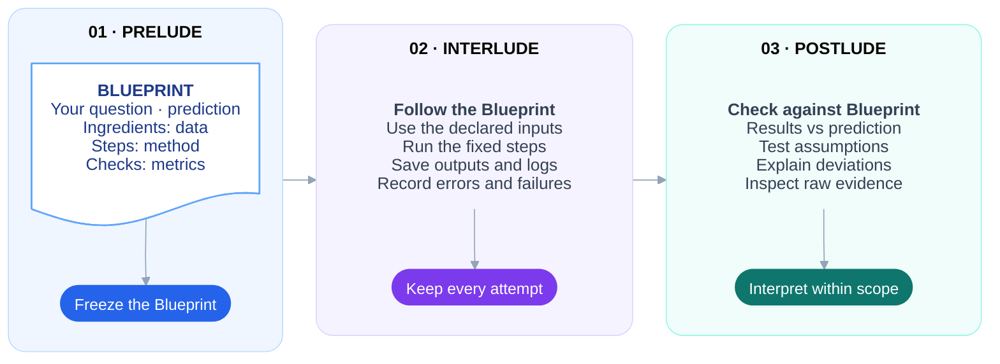

# Omnilude

**An experimental plugin for structuring and reviewing AI-assisted experiments.**

> [!NOTE]
> Built around research workflows, Omnilude can also support bounded software
> experiments and data analysis. It records assumptions, methods and results
> for human review. It does not guarantee correct conclusions, and its
> effectiveness has not yet been measured.



## TL;DR

| Part | What it means |
|---|---|
| Blueprint | Your experiment's recipe: question, prediction, data, method, metrics, assumptions, checks, budget and stopping rule |
| Prelude | Start with your question, prediction and metrics; freeze the Blueprint before running |
| Interlude | Run the experiment locally; retain outputs, logs and every attempt, including failures |
| Postlude | Compare results with the prediction; inspect evidence before interpreting |
| Revisions | Freeze a new Blueprint version; keep previous versions and attempts. Changes after results are exploratory |
| Codex | Helps plan, code and interpret in the current chat |
| Omnilude | One skill covers Prelude, Interlude and Postlude; local MCP tools record protocols and runs, with CLI access to the same functions |
| Setup | No Docker, separate agent process or additional model API key. Your experiment may need its own key |
| Clients | Codex is the primary client; shared skill and backend for [other clients](#distribution-and-compatibility) |

[Install](#install) · [Research workflow](#research-workflow) ·
[CLI example](#try-it-from-the-terminal) · [Tool reference](#tool-reference) ·
[Sources](#design-traceability)

## What it does

| Function | What you get |
|---|---|
| Conversational planning | Your question, prediction and metrics first; attributed suggestions and reusable decisions |
| Checkable assumptions | A statement, reason, control and expected outcome for each assumption |
| Frozen methods | Exact protocol and file versions; light/full review; linked revisions |
| Local execution | Background runs, progress, stop and recovery; failures retained |
| Evidence review | Logs, artifacts, numeric metrics, integrity checks and assumption outcomes |
| Chat and CLI access | The same Python functions through MCP tools or terminal commands |

| Boundary | Current limit |
|---|---|
| Capture | Records activity through Omnilude's tools, not the whole chat |
| Access | Commands run with the host user's access; no data isolation |
| Conclusions | Passing checks does not establish the research hypothesis |
| Effectiveness | Improvements in verification speed, accuracy or calibration have not been measured |

## Install

| Requirement | Details |
|---|---|
| Platform | macOS or Linux |
| Runtime | Python 3.12+ and [uv](https://docs.astral.sh/uv/getting-started/installation/) |
| Client | Codex with local plugin support; `uv` on Codex's `PATH` |
| Source checkout | Build a clean bundle with the first block below |
| Ready-made bundle | Extract it and skip the build; use its absolute folder path in the install command |

```bash
uv sync
python3 scripts/package_plugin.py --output ../omnilude-plugin
```

```bash
codex plugin marketplace add /absolute/path/to/omnilude-plugin
codex plugin add omnilude@omnilude-local --json
codex plugin list --json
```

| Step | What to do or expect |
|---|---|
| Package | Use a new or empty output directory. Install the clean bundle, not the working tree |
| Bundle contents | Explicitly selected runtime files, one skill, manifests, README and locked dependencies; excludes scratch scripts, `.git`, `.venv`, `.env`, run stores, tests and caches |
| Developer material | Packaging commands, tests and `AGENTS.md` links require the [source checkout](https://github.com/MatteoLeonesi/omnilude); these files are not in the clean bundle |
| Open | Start a new chat in your research project; select or mention Omnilude |
| Missing tools | Refresh the plugin list or restart Codex |
| First call | May install locked dependencies |
| Source changes | Repackage and reinstall; Codex loads an installed copy |
| Distribution | Registers a local marketplace, not a public release. [Local marketplace documentation](https://developers.openai.com/plugins/build/plugins#how-local-marketplaces-work) |

<details>
<summary>Update, uninstall, or launch the server manually</summary>

| Before updating | Requirement |
|---|---|
| Active runs | Finish them first |
| Updated checkout | Package into a new directory |

```bash
python3 scripts/package_plugin.py --output ../omnilude-plugin-updated
codex plugin remove omnilude@omnilude-local
codex plugin marketplace remove omnilude-local
codex plugin marketplace add ../omnilude-plugin-updated
codex plugin add omnilude@omnilude-local --json
```

| Action | Details |
|---|---|
| Load the update | Restart Codex or open a new chat |
| Uninstall only | Run the two `remove` commands above |
| Records | Stay in each project's `.omnilude` directory, outside the plugin cache; back up the whole directory |
| Manual MCP server | STDIO command `uv`; args `["run", "--frozen", "--no-dev", "--directory", "/absolute/path/to/Omnilude", "omnilude", "mcp"]` |
| Installed location | [mcp.json](mcp.json) uses `${PLUGIN_ROOT}`, an [official local-server placeholder](https://developers.openai.com/plugins/deploy/desktop-only#configure-a-local-mcp-server) |
| Server interaction | Waits for MCP messages; it is not an interactive terminal program |

</details>

## Distribution and compatibility

| Package | Contents or behavior |
|---|---|
| Shared components | One [skill](skills/omnilude/SKILL.md) for Prelude, Interlude and Postlude, plus the local MCP server; the same research rules and records across clients |
| Entry points | [plugin.json](plugin.json) and [mcp.json](mcp.json), plus Codex and Claude Code compatibility metadata |
| Skill discovery | “Portable packages discover `skills/` automatically.” [Package format](https://developers.openai.com/plugins/deploy/submission#package-identity-and-components) |
| Skill-only install | Does not connect the execution tools |

| Client | Current status |
|---|---|
| Codex | Local marketplace package; MCP workflow tested |
| Claude Code | Manifest and shared MCP server validated; complete research conversations still need testing |
| Other MCP clients | Manual STDIO connection available; client-specific installation unverified |

Preview the clean bundle in Claude Code:

```bash
claude --plugin-dir /absolute/path/to/omnilude-plugin
```

Invoke `/omnilude:omnilude`. For a persistent local install:

```bash
claude plugin marketplace add /absolute/path/to/omnilude-plugin
claude plugin install omnilude@omnilude-local
```

| Claude Code | Details |
|---|---|
| Installation | [Official plugin mechanisms](https://code.claude.com/docs/en/plugins) |
| Installed location | Manifest uses `${CLAUDE_PLUGIN_ROOT}` |

| Public store | Status or requirement |
|---|---|
| Publication | Not published; the local package is a distribution candidate |
| Eligibility | “Local MCP submissions are limited to approved partners.” [Local MCP eligibility](https://developers.openai.com/plugins/deploy/desktop-only#submit-a-plugin-with-a-local-mcp-server) |
| Required materials | Organization eligibility, verified publisher identity, product/support/privacy/terms URLs, icons and review materials |
| Submission | Materials have not been invented or submitted. Once supplied, upload the clean ZIP for review; publish after approval. [Submission requirements](https://developers.openai.com/plugins/deploy/submission) |

## Research workflow

Start in your own words:

> Use Omnilude for a light experiment in this project. My question is …
> My prediction is … The metric I want to measure is …

| Stage | What happens |
|---|---|
| Prelude: your input | Question, prediction and metrics first. Record their source and any prior exposure to agent suggestions or results |
| Missing information | Reuse what you already said; ask only for gaps. If you have no prediction or metric yet, say so; label any later assistant proposals |
| Specify | Fix data and permitted uses, metric definitions, success criteria, run selection/aggregation, constraints, commands, assumptions, controls, budget and stopping rule |
| Freeze the Blueprint | Write the method without results; snapshot selected files and inputs; identify the exact version with a hash. Execution is blocked until freeze |
| Interlude | Start the run; receive a run ID immediately. Follow status, stop or recover an interrupted attempt |
| Postlude | Show results beside the prediction, then deviations, assumption checks and raw evidence. Inspect examples, failures and surprises alongside aggregate metrics |
| Revise | Fork the frozen protocol into a new draft; retain the earlier version and every attempt |

### Light, full, exploration and confirmation

Choose a review tier (light/full) and a research mode (exploration/confirmation).

| Choice | Rule |
|---|---|
| **Light** | At most three assumptions; no separate method approval |
| **Full** | Approve the exact previewed protocol hash; declare a known-outcome control or explain why it is inapplicable |
| **Exploration** | Probe a bounded question; retain changes, anomalies and inconclusive results |
| **Confirmation** | Fix hypothesis, prediction, analysis and stopping rule before the run |

| Decision | Rule |
|---|---|
| Assumptions | Record statement, reason (`warrant`), check, expected outcome and author |
| Agent proposals | Require user acceptance, including in light mode. Related proposals can be accepted together; their author stays unchanged |
| Existing decisions | Reuse unchanged accepted assumptions without another acceptance |
| Full approval | A separate decision about the exact whole-protocol version |
| Routine choices | Within agreed constraints, the assistant records its choice, reason and rejected alternative |
| Frozen choices | Changes require a fork |
| After a run | A fork after any attempt starts as exploratory; later confirmation needs a fresh-data declaration and a new freeze |
| Fresh data | The tool records the declaration; it cannot establish that the chat has never seen the data |

| Responsibility | Coverage |
|---|---|
| Enforced by tools | Schemas, required fields, pending assumption acceptance, full-tier approval hashes, freeze-before-run, file integrity and run limits |
| Guided by the skill | Conversation order, results-free method, acceptance of other substantive proposals, sensible controls and calibrated conclusions |
| Human provenance | Decisions copied from chat remain reported provenance; the server cannot authenticate authors or inspect a method's meaning |

### Read the result correctly

| Record | Meaning |
|---|---|
| Run states | `created` → `running` → `sealed` → `checked` |
| `sealed` | Evidence retained; no claim of scientific success |
| `checked` | Mechanical assessment stored; no claim of scientific success |
| Check rows | `supported`, `failed` or `unsupported`, within the check's scope |
| Supported metrics row | Declared numeric fields exist; correctness of their calculation remains unverified |
| Agent-authored check | May have `check_status: passed` while its assumption remains `unsupported` |
| Researcher-declared check | A passing check still needs its warrant reviewed |
| Scientific status | `hypothesis_status: not_assessed`; `evidence_status: inconclusive`. Record interpretation separately |
| Work status | `work_status: completed` means the worker is no longer active |
| Negative outcomes | A failed test or non-detection does not automatically count against the broader hypothesis |
| Expected failure | A deliberately nonzero `expected_exit` can represent a successful negative test |

## Try it from the terminal

<details>
<summary>Copy-and-run example: create → freeze → run → verify</summary>

| Example | Details |
|---|---|
| Purpose | Documentation fixture; tests the same functions used by MCP |
| Requirements | No Docker, model call or external data |
| Prediction | Known answer supplied by the fixture, not an independent researcher's prediction |
| Execution | Run every block in the same terminal, from the repository checkout |

1. Create a fresh project and script:

```bash
omnilude_project="$(mktemp -d)"
cat > "$omnilude_project/main.py" <<'PY'
import json
import os
from pathlib import Path

value = sum([1, 2, 3])
output = Path(os.environ["OMNILUDE_OUTPUT_DIR"])
(output / "metrics.json").write_text(json.dumps({"total": value}))
print(value)
PY
```

2. Describe the protocol and method:

```bash
cat > "$omnilude_project/spec.json" <<'JSON'
{
  "kind": "research",
  "schema_version": 1,
  "title": "Documentation smoke test",
  "question": "Does the example script save the sum of 1, 2 and 3?",
  "prediction": "The total will be 6; this is a known-answer fixture.",
  "metrics": [{"name": "total", "definition": "Sum of the three integers"}],
  "researcher_source": "Copied documentation fixture, not independent research input.",
  "after_agent_suggestions": true,
  "tier": "light",
  "mode": "exploration",
  "workspace_paths": ["main.py"],
  "data_policy": "Use only the three literal integers in main.py.",
  "selection_rule": "One run; retain its output even if it fails.",
  "success_criteria": "The saved total equals 6.",
  "constraints": ["No network or external data needed."],
  "stopping_rule": "Stop after one attempt or the command timeout.",
  "command": ["python3", "main.py"],
  "timeout_seconds": 10,
  "max_runs": 1,
  "artifacts": [{"path": "output/metrics.json"}],
  "metrics_path": "output/metrics.json"
}
JSON
cat > "$omnilude_project/METHOD.md" <<'MD'
Sum the three literal integers once. Save the numeric total in a JSON file
and print it. Inspect the saved value against the known-answer criterion.
MD
```

3. Create, preview and freeze the draft:

```bash
uv run omnilude research --project "$omnilude_project" create \
  --workspace "$omnilude_project" --spec "$omnilude_project/spec.json" \
  > "$omnilude_project/draft.json"
experiment_id="$(python3 -c 'import json,sys; print(json.load(open(sys.argv[1]))["id"])' "$omnilude_project/draft.json")"
uv run omnilude research --project "$omnilude_project" preview "$experiment_id" \
  --method-file "$omnilude_project/METHOD.md"
uv run omnilude research --project "$omnilude_project" freeze "$experiment_id" \
  --method-file "$omnilude_project/METHOD.md"
```

4. Run once, verify and read the evidence:

```bash
uv run omnilude research --project "$omnilude_project" run "$experiment_id" \
  --foreground > "$omnilude_project/run.json"
run_id="$(python3 -c 'import json,sys; print(json.load(open(sys.argv[1]))["run_id"])' "$omnilude_project/run.json")"
uv run omnilude research --project "$omnilude_project" verify "$run_id"
uv run omnilude research --project "$omnilude_project" report "$run_id"
uv run omnilude research --project "$omnilude_project" evidence "$run_id" \
  execution/command/stdout.log
```

| Result or option | Expected behavior |
|---|---|
| Report | `metrics: {"total": 6}`, state `checked`, hypothesis `not_assessed` |
| Scientific check | Inspect the value against 6 separately from the automatic JSON-format check |
| Background run | Omit `--foreground`; poll `status RUN_ID` until `sealed`, then call `verify RUN_ID` |

</details>

## Tool reference

<details>
<summary>Commands, protocol fields, evidence files and troubleshooting</summary>

| Interface | Contract |
|---|---|
| Project | Absolute, existing directory; records stored at `<project>/.omnilude` |
| Alternate CLI store | `--root /absolute/store` |
| CLI prefix | `uv run omnilude research --project PROJECT`; append an action below |
| MCP | Same action names with a `research_` prefix and `project` argument; `research_schema` takes none |
| Placeholders | Replace `PROJECT`, `EXPERIMENT_ID` and `RUN_ID` with actual paths or IDs |

| CLI action | Purpose |
|---|---|
| `schema` | Print all spec fields, types and defaults; no project required |
| `create --spec spec.json --workspace /absolute/workspace` | Save a draft and its workspace location |
| `get EXPERIMENT_ID` | Read the spec, state and provenance |
| `update EXPERIMENT_ID --spec spec.json` | Replace an unfrozen spec; retain the previous revision |
| `preview EXPERIMENT_ID --method-file METHOD.md` | Show readiness, blockers, protocol hash and assumption hashes |
| `freeze EXPERIMENT_ID --method-file METHOD.md [--approval approval.json]` | Pin the exact method, spec and selected files |
| `fork EXPERIMENT_ID` | Create a linked editable revision |
| `run EXPERIMENT_ID [--foreground]` | Start an attempt; background is the default |
| `status RUN_ID` | Read progress, manifest and stop request |
| `stop RUN_ID --reason "reason"` | Request cancellation; inspect status afterwards |
| `recover RUN_ID` | Retain partial evidence after an interrupted worker; never rerun |
| `verify RUN_ID` | Assess a sealed record once, without rerunning commands |
| `report RUN_ID` | Read prediction, metrics, deviations, checks and all attempts for that experiment |
| `evidence RUN_ID REF [--max-chars 20000]` | Read a referenced text artifact; maximum 100,000 characters |
| `record RUN_ID decision\|observation\|interpretation --payload note.json` | Append an attributed assistant account |
| `list` | List research experiments and their attempts |

| Arguments and reports | Contract |
|---|---|
| `report` | Does not run `verify`; metrics and check rows appear after verification |
| MCP arguments | `spec`, `approval` and `payload` are objects; `method` is text. The CLI reads these from files |
| Decision payload | Nonempty strings: `choice`, `reason`, `rejected_alternative` |
| Observations and interpretations | Include evidence references |
| Accounts | Require an existing run; never become authenticated user approvals |

<details>
<summary>Record acceptance and full-tier approval</summary>

| Assumption acceptance | Action |
|---|---|
| Read the hash | `preview.assumption_hashes[ASSUMPTION_ID]` |
| Record consent | After actual user acceptance, add the object below to the assumption's `acceptance` field and update the draft |
| Preserve origin | Keep `author: "agent"` |
| Changed assumption | Earlier acceptance becomes stale |
| Grouped acceptance | One user statement can accept several identified proposals; record it with each corresponding hash |

```json
{
  "statement": "The user's actual acceptance statement",
  "reference": "A reference to that statement in the conversation",
  "subject_hash": "THE_64_CHARACTER_ASSUMPTION_HASH"
}
```

| Full approval and confirmation | Action or limit |
|---|---|
| Full preview | After all changes, preview again and present the method and exact version to the user |
| Approval file | Save the same three fields in `approval.json`; set `subject_hash` to `protocol_hash` |
| Freeze | Pass `--approval approval.json` |
| Version scope | Hash includes spec, method and selected input/workspace files. Any change needs a new preview and approval |
| Consent | Fill placeholders only with actual user consent |
| Confirmation | Set `mode: "confirmation"`, `hypothesis` and `analysis_plan`, plus the normal prelude and stopping rule |
| Confirmation after a post-run fork | Also provide `fresh_data_statement` |
| Declaration limits | Recorded commitments; no automatic test of data independence or statistical adequacy |

</details>

### Files, commands and limits

| Setting | Contract |
|---|---|
| `workspace_paths` | Relative files/directories to copy from the workspace; default `[]` copies no code |
| `inputs` | Each has `name`, `path`, `role`, `usage`; relative paths resolve from the source workspace |
| `command` | Argument list executed directly in the copied workspace; no arguments are appended automatically |
| `artifacts` | Workspace-relative file paths; `required` defaults to `true` |
| `metrics_path` | Optional workspace-relative JSON file; no default filename |
| `assumptions[].check_command` | Optional argument list; each check runs in its own copy of the completed workspace |
| `expected_exit` | Expected exit code for the main command or a check; default `0` |
| `timeout_seconds` | Default `60`, applied separately to the main command and each check |
| `max_runs` | Default `1`; every local attempt counts, including failures and interruptions |
| `budget_usd` | Optional recorded budget; local spending is not metered or blocked |
| `env_vars` | Explicit environment names to pass to the command; each must exist in the server environment |

| Execution detail | Contract |
|---|---|
| Provided variables | `OMNILUDE_RUN_ID`, `OMNILUDE_INPUTS_DIR`, `OMNILUDE_OUTPUT_DIR` |
| Outputs | `output/` inside the copied workspace |
| Input copies | Files: `<name>/<basename>`. Directories: `<name>/...` |
| Shell | Runs only when the declared command explicitly launches one |
| Dependencies | Install dependencies and choose the interpreter before freezing; Omnilude does not build an isolated environment |
| Metrics format | One JSON object, at most 8 MB; exactly the declared metric names and finite numeric values |
| Rejected metrics | Strings, booleans, missing/extra names, NaN and infinity |
| Metrics meaning | Definitions and units stored in the spec; arbitrary metrics are not independently rescored |
| Snapshot exclusions | `.git`, `.venv`, `.omnilude`, `.env`/`.env.*`, `node_modules` and common caches |
| Input restrictions | Reject symlinks and special files; keep inputs separate from the store. Do not select credentials as inputs |
| Inherited environment | `PATH`, `LANG`, `LC_ALL`, `TMPDIR` and declared `env_vars` |
| Environment logging | Runner does not log values; your program can still print them or write them into artifacts |
| Recorded policies | Selection/aggregation, success criteria, permitted data use, constraints and textual stopping rule |
| Execution limits | Numeric timeout and run cap enforced; no interpretation of policies or enforcement of network/data access. Add executable checks for testable policies |

### Records and recovery

| Stored item | Location or contents |
|---|---|
| Database | `omnilude.sqlite3` in the project store |
| Frozen protocols | `experiments/<id>/` |
| Run evidence | `records/<run-id>/` |
| Captured facts | Commands, available environment metadata, timestamps, exit codes, stdout/stderr, input copies, workspace snapshots and check outcomes |
| Standard output | `execution/command/stdout.log` |
| Standard error | `execution/command/stderr.log` |
| Process result | `execution/command/result.json` |
| Example metrics | `execution/workspace/output/metrics.json` |
| Assumption check | `execution/checks/<assumption-id>/result.json` |
| Read evidence | Use report paths; `evidence` reads text. Open other files from the store |

| Integrity and recovery | Rule |
|---|---|
| Frozen/sealed files | Do not edit them; verification detects changes against recorded hashes |
| Stored evaluation | Reports recheck integrity and flag stale evaluations |
| Backup | Copy the whole store, preferably with no active workers; the SQLite file alone is insufficient |
| Uninstall | Leaves the store intact |
| Uncertain outcome | No automatic retry |
| Recovery | Preserves partial evidence; does not resume or repeat the command |

| Situation | What to do |
|---|---|
| Tools unavailable | Check `codex plugin list --json`, `uv` on Codex's PATH, and a new chat/restart |
| First MCP connection times out | Run `uv sync --frozen --no-dev --directory /absolute/installed/plugin` using `installedPath` from the install JSON, then reopen the chat. Warm the installed copy, not the clean source bundle |
| Freeze blocked | Read `preview.blocking_reason`; finish required fields or record actual proposal acceptance/approval |
| Full approval stale | Preview the changed version and obtain approval for that exact hash |
| Missing code or dependency | Check `workspace_paths`, command interpreter and environment; revise through a fork if already frozen |
| Timeout, failed check or missing output | Inspect the saved logs and rows; preserve the attempt before deciding on another run |
| Chat closes during a run | Read `list` and `status`; the detached worker may still be running |
| Worker interrupted | Call `recover`; it refuses unsafe recovery while a worker/process may still be active |
| Run cap reached | Fork with an explicit reason and revised budget; the earlier attempts remain visible |
| Verification interrupted | Inspect the stored evaluation and evidence; the one-time evaluation reservation is not silently retried |

### Scope of the evidence

| Boundary | Limit |
|---|---|
| Host access | Commands run with the host user's access; copies and hashes provide records, not data isolation or a security boundary |
| Visibility | Prediction and target remain visible in the same chat |
| Capture | Omnilude tools and commands only; excludes other chat actions, temporary edits and external processes |
| Missing metadata | Model IDs, sampling parameters, token usage and cost remain unavailable unless supplied with provenance |
| Approval | Local records cannot authenticate a human's approval |
| Scientific meaning | Evidence-capture limits and mechanical checks are separate from the scientific question |

</details>

## Design traceability

| Source | Role |
|---|---|
| Reading list | Original sources and exact passages linked below |
| Design provenance | Requirement IDs P1–P18 and D3/D4/D8 are retained from the original design; their current scope is summarized below |
| Exact passages below | Links to original words; “excerpt” means part of a longer sentence |
| Strength of evidence | Design motivation; no demonstrated improvement in research quality, verification speed or calibration |

| Idea | Exact source passage | How Omnilude uses it; strength of support |
|---|---|---|
| Researcher first | Excerpt: [“accepting one of the next research directions my agent gives me after completing an experiment instead of typing my own”][source-hgar] — HGAR, footnote 3 | Collect the researcher's position before suggestions. Anecdotal motivation, not evidence that this ordering works. |
| Record a prediction | [“What result do I expect to get? Is learning that useful?”][source-prediction] — Hughes & Perez, Part 3 | Save the expected result before the run. Practitioner advice; the recording procedure is our adaptation. |
| Use proportionate process | [“De-risk mode focuses on rapidly answering high-priority questions with minimal overhead.”][source-light] — Hughes & Perez, Part 3 | Light/full tiers. The three-assumption cap and approval rules are our choices. |
| Pin metrics, data and reporting | [“The system thus misinterprets metric requirements or substitutes them with alternatives, and deviates from the original experimental design.”][source-pitfalls] — Hidden Pitfalls, §5.3; data/selection in §§5.2/5.4 | Define metrics, data use and run selection explicitly. Observed failures motivate this; the paper does not validate our remedy. |
| Freeze the method | Excerpt: [“the paper is frozen to an immutable identifier before any result is seen”][source-freeze] — Automated Alignment Researchers, §3.2 | Freeze a results-free method and exact files. An implementation precedent, not evidence for our approval step's effectiveness. |
| Attribute suggestions | [“An ai-suggested event never auto-upgrades until the researcher explicitly confirms it, preserving the epistemic integrity of the artifact.”][source-origin] — Agent-Native Research Artifacts, §3.2 | Keep proposals pending until accepted. A design precedent; our chat provenance remains reported, not authenticated. |
| Keep failed attempts | [“This additional manual inspection yielded far more examples of reward hacking than the high-scoring heuristic alone, since many attempts at reward hacking failed.”][source-attempts] — METR, Methodology | Retain unsuccessful attempts and inspect more than high scores. This does not imply that ordinary failures are reward hacking. |
| Review assumptions and reasons | Excerpt: [“Human judgement is required to check the evidence, the assumptions, and the narrative justifications for the reasoning steps”][source-assurance] — Assurance 2.0 defeaters paper, abstract | Record warrants and evidence. Per-assumption checks and expected outcomes are our adaptation; passing one does not establish hypothesis truth. |
| Results before interpretation | Excerpt: [“begin with the empirical result, then enough experimental detail to understand what was done, and only then interpretation”][source-report] — Daniel Tan, Low-friction reviewing | Present result, method and interpretation separately. Practitioner advice, not a measured usability benefit. |

### Requirement coverage

Implementation and behavioral tests; no scientific validation of the methodology.

| Historical requirement | Current implementation | Verification |
|---|---|---|
| P1: researcher input before options | [Skill](skills/omnilude/SKILL.md); prelude and prior-exposure fields | [Protocol tests](tests/test_research_protocol.py) check retained provenance; chat order itself is a skill instruction |
| P7: researcher selection or randomized option order | **Partial:** prelude before suggestions is specified; option selection/randomization is not implemented as a rule | No test establishes the full historical P7 requirement |
| P2–P6, P18: metrics, data, selection, success and entry points | [Typed spec](omnilude/research_spec.py), [freeze and snapshots](omnilude/research.py); semantic policies remain declarations | [Protocol](tests/test_research_protocol.py) and [runner](tests/test_local.py) tests |
| P9–P10: ranked, checkable assumptions | Statement, warrant, check, expected outcome, origin; known-outcome declaration in full tier | [Protocol](tests/test_research_protocol.py) and [check-outcome tests](tests/test_local.py) |
| P11, P16: decisions and proposal provenance | Hash-bound assumption acceptance; assistant accounts retain choice, reason and alternative | [Protocol](tests/test_research_protocol.py) and [account tests](tests/test_local.py); accounts currently require a run ID |
| P12–P15: frozen method, revisions, light/full | Exact-version full approval; light cap of three assumptions; linked forks | [Protocol tests](tests/test_research_protocol.py) |
| P17: bounded investigation | Numeric timeout/run cap enforced; monetary budget and textual stopping rule recorded only | [Runner tests](tests/test_local.py): failures, timeout, stop and recovery. Budget design is ours, not an established KB finding |
| P8: hide prediction/target from executor | **Explicitly waived for this same-chat plugin** | Prediction remains visible; no blinding claim |
| D8: separate final data and host scoring | Outside the local plugin's scope | Local reports explicitly declare no isolation or independent scoring |
| D3–D4: validity is distinct from hypothesis truth | Mechanical checks and interpretation remain separate; local hypothesis status stays unassessed | [Runner](tests/test_local.py) and [real MCP lifecycle tests](tests/test_research_interfaces.py) |

| Additional coverage | Status |
|---|---|
| [Packaging tests](tests/test_plugin_package.py) | Required files, exclusion of scratch code and private state, and paths with spaces |
| [Storage tests](tests/test_spec_store.py) | Research records, state transitions and append-only evidence |
| Historical roadmap | No independent model verifier or monitor claimed as implemented |

[source-hgar]: https://www.lesswrong.com/posts/8KrTuCAzL2fdYHNrv/human-guided-agentic-research-a-research-agenda#:~:text=accepting%20one%20of%20the%20next%20research%20directions%20my%20agent%20gives%20me%20after%20completing%20an%20experiment%20instead%20of%20typing%20my%20own
[source-prediction]: https://www.alignmentforum.org/posts/6P8GYb4AjtPXx6LLB/tips-and-code-for-empirical-research-workflows#:~:text=What%20result%20do%20I%20expect%20to%20get%3F%20Is%20learning%20that%20useful%3F
[source-light]: https://www.alignmentforum.org/posts/6P8GYb4AjtPXx6LLB/tips-and-code-for-empirical-research-workflows#:~:text=De-risk%20mode%20focuses%20on%20rapidly%20answering%20high-priority%20questions%20with%20minimal%20overhead.
[source-pitfalls]: https://arxiv.org/html/2509.08713v2#:~:text=The%20system%20thus%20misinterprets%20metric%20requirements%20or%20substitutes%20them%20with%20alternatives%2C%20and%20deviates%20from%20the%20original%20experimental%20design.
[source-freeze]: https://alignment.anthropic.com/2026/automated-alignment-researchers/#:~:text=the%20paper%20is%20frozen%20to%20an%20immutable%20identifier%20before%20any%20result%20is%20seen
[source-origin]: https://arxiv.org/html/2604.24658#:~:text=An%20ai-suggested%20event%20never%20auto-upgrades%20until%20the%20researcher%20explicitly%20confirms%20it%2C%20preserving%20the%20epistemic%20integrity%20of%20the%20artifact.
[source-attempts]: https://metr.org/blog/2025-06-05-recent-reward-hacking/#:~:text=This%20additional%20manual%20inspection%20yielded%20far%20more%20examples%20of%20reward%20hacking%20than%20the%20high-scoring%20heuristic%20alone%2C%20since%20many%20attempts%20at%20reward%20hacking%20failed.
[source-assurance]: https://arxiv.org/html/2405.15800#:~:text=Human%20judgement%20is%20required%20to%20check%20the%20evidence%2C%20the%20assumptions%2C%20and%20the%20narrative%20justifications%20for%20the%20reasoning%20steps
[source-report]: https://www.lesswrong.com/posts/f4WZ7dde8KAYHfeif/tips-on-leveraging-ai-for-empirical-research#:~:text=begin%20with%20the%20empirical%20result%2C%20then%20enough%20experimental%20detail%20to%20understand%20what%20was%20done%2C%20and%20only%20then%20interpretation

## Development

```bash
uv sync
uv run ruff format .
uv run ruff check .
uv run pytest
```

| Reference | Scope |
|---|---|
| [AGENTS.md](AGENTS.md) | Coding rules |
| This README | Single project reference for design rationale, source passages and current contracts |
| Tests | Software behavior, not empirical effectiveness of the research methodology |
